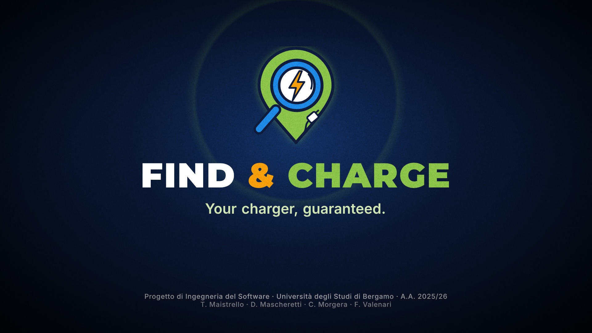

# Find & Charge: 30-second promo video

[](FindAndCharge_Promo_30s.mp4)

▶️ **[FindAndCharge_Promo_30s.mp4](FindAndCharge_Promo_30s.mp4)** (1920×1080, 30 fps, H.264 + AAC, 30 s)

## Storyboard

| Time | Scene | On-screen text |
|---|---|---|
| 0–3 s | Dusk, wet parking lot: the charger is red and already occupied (3D) | *Arrived. Charger taken. Again.* |
| 3–6 s | Dashboard: battery drops to 8% | *No free charger nearby. / Sound familiar?* |
| 6–10 s | App: map of Dalmine with free/booked/busy/broken pins, tap on a charger | *Find a charger near you.* |
| 10–14 s | Booking: "Giorno", "Orario (slot 30 min)", car selection, **Prenota ora** → "Prenotazione confermata!" | *Book your slot in advance.* |
| 14–16.5 s | The booked charger waits with its LED green (3D) | *It's waiting for you.* · RISERVATA PER TE · 18:30 |
| 16.5–22.5 s | The driver arrives, scans the booking QR code, takes the connector and plugs in the car (3D) | *Scan. Plug. Charge.* |
| 22.5–24.5 s | Close-up of the connector going into the port; the ring lights up (3D) | — |
| 24.5–27 s | App: charge rising to 80% and a 5/5 rating ("Dai un Voto al Servizio") | *Charge. Rate. Go.* |
| 27–30 s | Logo end card | *Your charger, guaranteed.* |

The structure follows what competitor promo videos do (ChargePoint, Zapmap, EVgo, Enel X Way): a problem hook in the first 3 seconds, the solution shown inside the app, then the end card. The script puts the differentiator up front: **booking guarantees the charger is free when you arrive**.

## How it was made (all procedural, no stock assets)

- **3D scenes** (`source/blender/scene.py`): Blender 5 (`bpy`) with Cycles. The car, charger, person, wet asphalt and lighting are all generated in code. Rendered at 960×540 with denoising, then upscaled to 1080p (`post.sh`).
- **App UI and motion graphics** (`source/index.html`): HTML/SVG/CSS that recreates the real Find&Charge screens (MapView, booking sidebar, QR "QR Code Prenotazione", rating). `renderAt(t)` draws each frame deterministically and `render.js` (Playwright) captures it.
- **Music and sound effects** (`source/music.py`): synthesized with numpy: a tense intro, a 120 BPM track that drops when you tap "Prenota ora", sound effects synced to the taps, the QR scan and the plug click, and a closing sonic logo.
- **Edit**: ffmpeg (libx264 CRF 18, AAC 192k).

```bash
# 1) 3D frames -> source/frames/shot1..shot4/0001.png  (see source/blender/*.sh)
# 2) UI + composite
cd source && node render.js ../out 0 30
# 3) audio + encode
python3 music.py music.wav
ffmpeg -framerate 30 -i ../out/%04d.jpg -i music.wav -c:v libx264 -crf 18 -pix_fmt yuv420p -c:a aac -b:a 192k -shortest FindAndCharge_Promo_30s.mp4
```

Fonts: Inter and Montserrat (Google Fonts, SIL Open Font License).
